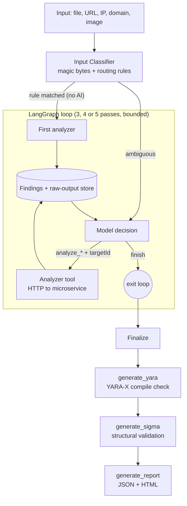
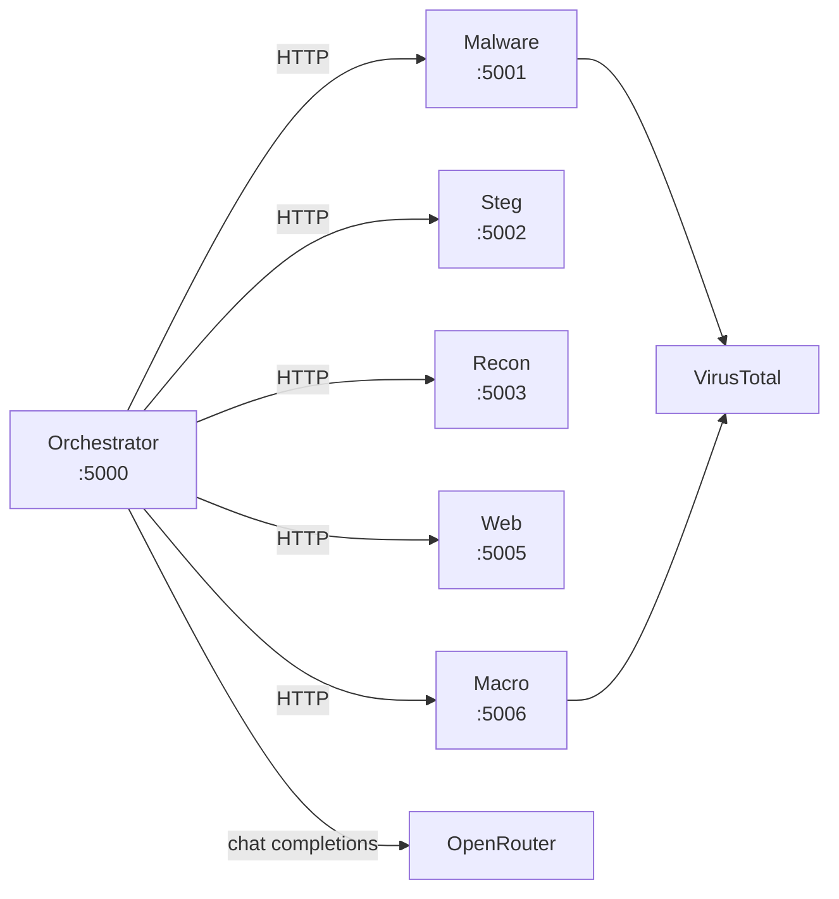
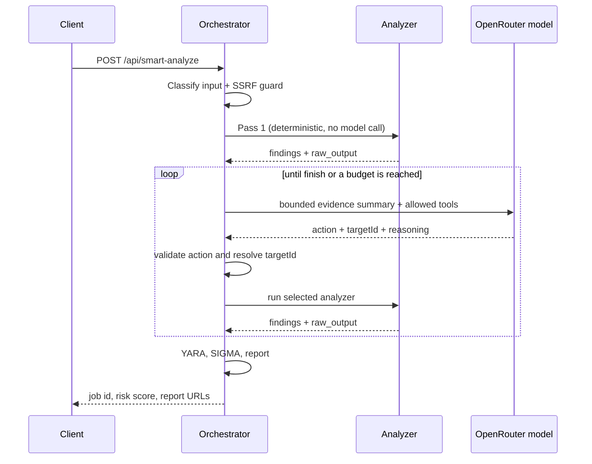
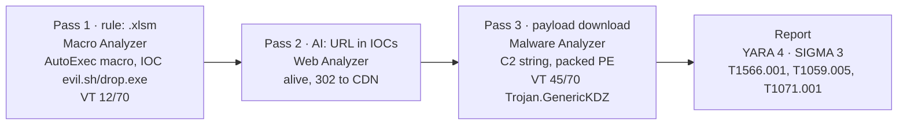
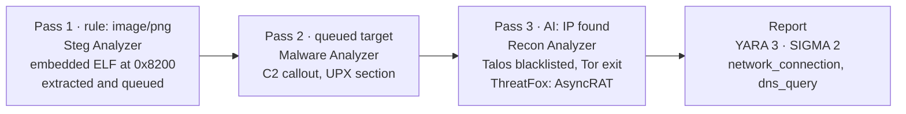
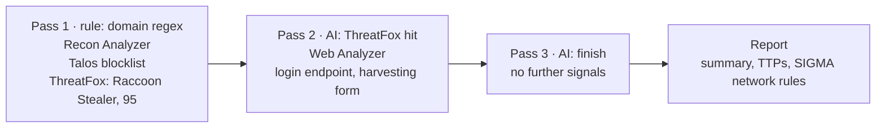

<div align="center">


# SecFlow

### Fully Automated Multi-Vector Threat Analysis Pipeline

[](https://typescriptlang.org)
[](https://nodejs.org)
[](https://langchain-ai.github.io/langgraphjs/)
[](https://openrouter.ai)
[](https://python.org)
[](https://docker.com)
[](https://virustotal.com)
[](LICENSE)
[](https://github.com/aradhyacp/SecFlow/pulls)

**Submit a file, URL, IP, domain, or image. SecFlow routes it to the right analyzer, lets an AI model decide what to investigate next, and produces a report with YARA rules, SIGMA rules, MITRE ATT&CK mappings, and a print-ready PDF export.**


[Quick Start](#quick-start) · [Architecture](#architecture) · [Report Output](#report-output) · [Docs](#documentation)

</div>

---

## What is SecFlow?

SecFlow is an open-source threat analysis pipeline for security analysts, SOC teams, and researchers. Instead of running separate tools by hand and correlating their output yourself, you hand SecFlow one input and it:

1. **Classifies** the input with deterministic rules. No AI is involved on the first pass.
2. **Routes** it to the matching analyzer, a containerized microservice called over HTTP.
3. **Reasons** over each pass's findings with an OpenRouter model, which picks the next analyzer or stops.
4. **Iterates** by following IOCs, downloading payloads, and pivoting across analyzers within strict budgets.
5. **Reports** with an HTML and JSON report containing YARA rules, SIGMA rules, MITRE ATT&CK mappings, and an executive summary.

The orchestrator is a TypeScript service built on a single LangGraph.js state graph. The model never touches the network or filesystem directly. It can only choose from a catalog of targets the backend has already validated.

---

## Features

| Feature | Detail |
|---|---|
| **AI-driven routing** | An OpenRouter model (default `nvidia/nemotron-3-ultra-550b-a55b:free`, configurable) picks the next analyzer after each pass using structured output |
| **Five specialized analyzers** | Malware, Steganography, Reconnaissance, Web Vulnerability, Macro/Office |
| **Deterministic first pass** | File and target rules choose the first analyzer. The model is only consulted when the type is ambiguous |
| **Download and analyze** | Follows IOCs by downloading payloads found in analyzer output and routing them to the right analyzer |
| **Evidence-grounded YARA** | 2–5 rules per analysis, compiled with YARA-X, each citing the evidence that produced it |
| **Evidence-grounded SIGMA** | 2–4 rules covering different log sources, structurally validated, with indicators checked against the evidence |
| **MITRE ATT&CK mapping** | Findings are mapped to technique IDs with tactic names |
| **Dual report formats** | Self-contained HTML (print to PDF) plus structured JSON |
| **SSRF protection** | Private, loopback, link-local, and cloud-metadata targets are blocked before and during analysis |
| **Bounded execution** | Pass, model-cycle, tool-call, and wall-clock budgets with a recorded termination reason |
| **React dashboard** | Submit analyses, follow pipeline progress, and browse results per analyzer |
| **Standalone analyzers** | Each microservice exposes its own REST API and can be used on its own |

---

## Architecture

SecFlow is an orchestrator plus five independent analyzer containers on one Docker network. The orchestrator owns routing, state, budgets, and reporting. Analyzers know nothing about the pipeline.



### Analyzer services



### Request lifecycle



### Design principles

- **Deterministic first.** If a rule matches the input, pass 1 runs without a model call.
- **The model only picks from a catalog.** Analyzer tools accept `{ targetId }`. The id must resolve in a trusted per-run catalog and match the tool's allowed target kinds. The model cannot supply URLs, paths, commands, or service addresses.
- **Evidence is data, not instructions.** Analyzer output is wrapped in `<untrusted_evidence>` boundaries. The model receives bounded summaries and references, never raw sample bytes or unbounded dumps. Prompts are guidance only. Schemas and code enforce the actual limits.
- **Failures stay visible.** An analyzer error becomes a structured tool error or finding and the run continues when other evidence exists. A run with no findings returns `500`. Analyzer output is never fabricated.
- **Everything is audited.** Each decision is logged with run id, pass, tool, target id, reasoning, and duration.

### Termination reasons

Every run ends with a recorded reason.

| Reason | Meaning |
|---|---|
| `model_finished` | The model returned `finish` with reasoning |
| `no_artifacts` | No untried tool/target pair remains |
| `max_passes` | The requested pass budget (3, 4, or 5) was reached |
| `max_cycles` | `MODEL_MAX_CYCLES` model decisions were used |
| `max_tool_calls` | `MODEL_MAX_TOOL_CALLS` analyzer executions were used |
| `duplicate_analysis` | The model requested a tool/target pair that was already attempted |
| `unsupported_input` | No analyzer accepts the input |
| `fatal_error` | Model contract failure or invalid tool output |

---

## Quick Start

### Prerequisites

- Docker and Docker Compose
- An OpenRouter API key (the default model has a free tier)
- A VirusTotal API key for malware and macro threat intelligence (optional, recommended)

### 1. Clone the repository

```bash
git clone https://github.com/aradhyacp/SecFlow.git
cd SecFlow/backend
```

### 2. Configure environment variables

```bash
cp .env.example .env
```

Edit `.env`:

```env
# Core keys
OPENROUTER_API_KEY=your_openrouter_api_key_here     # Required
VIRUSTOTAL_API_KEY=your_vt_api_key_here             # Recommended

# Optional: additional OSINT capabilities
NUMVERIFY_API_KEY=your_numverify_key      # Phone number lookups
THREATFOX_API_KEY=your_threatfox_key      # Higher ThreatFox rate limits
ipAPI_KEY=your_ipapi_key                  # Higher ip-api.com rate limits

# Orchestrator model and limits
OPENROUTER_MODEL=nvidia/nemotron-3-ultra-550b-a55b:free
MODEL_MAX_CYCLES=12
TOTAL_ANALYSIS_TIMEOUT_MS=600000
ALLOW_PRIVATE_TARGETS=false                # true only for local demos
```

### 3. Start all services

```bash
docker compose up -d
```

This starts the six core services, plus the PostgreSQL, Redis, and worker containers used by the Steg analyzer.

| Service | Port | Role |
|---|---|---|
| `orchestrator` | `5000` | Pipeline controller and main entry point |
| `malware-analyzer` | `5001` | Ghidra decompilation + VirusTotal |
| `steg-analyzer` | `5002` | binwalk, zsteg, steghide, ExifTool |
| `recon-analyzer` | `5003` | ip-api, ThreatFox, OSINT |
| `web-analyzer` | `5005` | HTTP vulnerability scanner + header audit |
| `macro-analyzer` | `5006` | oletools (olevba) + VirusTotal |

> **Note:** The first start can take several minutes. The Malware Analyzer downloads Ghidra 12.0.1 (about 500 MB) and needs a JDK 21 JVM.

### 4. Run your first analysis

**Analyze a file:**

```bash
curl -X POST http://localhost:5000/api/smart-analyze \
  -F "file=@/path/to/suspicious.exe" \
  -F "passes=3"
```

**Analyze a URL, IP, or domain:**

```bash
curl -X POST http://localhost:5000/api/smart-analyze \
  -H "Content-Type: application/json" \
  -d '{"target": "example.com", "passes": 3}'
```

> Private and loopback addresses such as `192.168.x.x` are rejected by the SSRF guard unless `ALLOW_PRIVATE_TARGETS=true`.

**Response (abridged):**

```json
{
  "job_id": "a1b2c3d4e5f60718",
  "passes_completed": 3,
  "overall_risk_score": 7.5,
  "findings_summary": { "...": "..." },
  "report_paths": {
    "json": "/api/report/a1b2c3d4e5f60718/json",
    "html": "/api/report/a1b2c3d4e5f60718/html"
  },
  "report_urls": { "...": "..." }
}
```

Open `http://localhost:5000/api/report/<job_id>/html` in a browser and use **Export PDF** to save the report.

### 5. Launch the frontend

```bash
cd ../frontend
npm install
npm run dev
```

Open `http://localhost:5173` for the React dashboard.

### Developing the orchestrator locally

Requires Node.js 20+ and the analyzer services running.

```bash
cd backend/orchestrator-ts
cp .env.example .env
npm install
npm run dev          # watch mode
```

| Command | Purpose |
|---|---|
| `npm run dev` | Start in watch mode |
| `npm run build` / `npm start` | Compile to `dist/` and run the build |
| `npm run typecheck` | Strict TypeScript check |
| `npm run lint` | ESLint |
| `npm run format` / `npm run format:check` | Prettier |
| `npm test` / `npm run test:watch` | Vitest. Live tests skip without API keys |

---

## Analyzers

### Malware Analyzer (port 5001)

Analyzes executables and binaries in three layers:

- **Ghidra 12.0.1** (via `pyghidra`): decompiles every function to C pseudo-code
- **`objdump -d`**: assembly-level disassembly
- **VirusTotal API v3**: detections from 70+ AV engines, behavioral tags, file reputation

**Supported:** `exe`, `dll`, `so`, `elf`, `bin`, `o`, `out` · Max 50 MB · Needs 4 GB RAM for the Ghidra JVM

---

### Steganography Analyzer (port 5002)

Detects hidden data in images:

- **binwalk**: finds and extracts embedded files at binary offsets
- **foremost**: file carving from raw binary streams
- **zsteg**: LSB steganography detection in PNG/BMP
- **steghide**: passphrase-based detection in JPEG/BMP
- **ExifTool**: metadata extraction and anomaly detection

Extracted archives and binaries are queued as new targets for later passes.

**Supported:** PNG, JPG, BMP, GIF, TIFF, WebP

---

### Reconnaissance Analyzer (port 5003)

Threat intelligence and OSINT on network identifiers.

**Scan mode** (IP / domain):

| Module | Source | What it checks |
|---|---|---|
| `ipapi` | ip-api.com | Country, ISP, ASN, geolocation |
| `talos` | Cisco Talos blocklist | IP reputation |
| `tor` | Tor Project exit list | Tor exit node detection |
| `tranco` | Tranco ranking list | Domain popularity rank |
| `threatfox` | abuse.ch ThreatFox | Active IOC and malware association |

**Footprint mode** (email / phone / username):

- **Email**: XposedOrNot breach database (breach count, severity, password risk)
- **Phone**: NumVerify carrier, country, and line type validation
- **Username**: Sagemode multithreaded profile discovery across social platforms

---

### Web Vulnerability Analyzer (port 5005)

Audits URLs and web endpoints:

- Security header analysis (CSP, HSTS, X-Frame-Options, and others)
- TLS/SSL, firewall, and DNS checks
- Technology fingerprinting (server, frameworks, CMS)
- HTTP response analysis and redirect chain following
- Malware reputation check and basic misconfiguration scanning

---

### Macro / Office Analyzer (port 5006)

Dissects Office documents for malicious macros:

- **oletools (olevba)**: extracts and decompiles VBA and XLM macros
- **AutoExec detection**: flags macros that run on open or close
- **IOC extraction**: URLs, IPs, and file paths embedded in macro code
- **Obfuscation detection**: Base64, `Chr()` chains, hex encoding
- **VirusTotal API v3**: file reputation cross-check

**Supported:** `doc`, `docx`, `docm`, `xls`, `xlsx`, `xlsm`, `xlsb`, `ppt`, `pptx`, `pptm`, `rtf`

---

## Report Output

Every run writes two reports under `REPORTS_DIR/<job_id>/`. For uploads the job id is derived from the file contents, so the same sample always maps to the same id.

### HTML report (`report.html`)

Self-contained, so it opens in any browser. Click **Export PDF** to use the browser print dialog. No server-side PDF rendering is needed.

It contains the executive summary, YARA rules, SIGMA rules, MITRE TTPs, per-pass evidence panels, and VirusTotal engine badges.

### JSON report (`report.json`)

A typed, machine-readable mirror of the HTML. Use it to:

- feed findings into another model for deeper analysis
- ingest into a SIEM or ticketing system
- diff two reports programmatically
- build custom dashboards

Report data is validated against a Zod schema before any file is written.

See [`examples/`](examples/) for sample inputs and [`example_reports`](example_reports/) for reports generated during development.

### Executive summary

A narrative written by the OpenRouter model from structured findings, covering:

- the identified threat and actor type
- a step-by-step attack chain
- a confidence rating and overall risk score

### YARA detection rules

2–5 rules generated by the configured model and compiled with YARA-X. Each rule:

- follows the `SecFlow_[ThreatCategory]_[IndicatorType]` naming convention
- uses valid YARA 4.x syntax
- cites the evidence refs it was derived from
- has its quoted string literals checked against the evidence, so a rule cannot invent an indicator
- ends in one of three states: `valid` (compiled and grounded), `generated` (YARA-X unavailable, syntax unconfirmed), or `invalid`

Rules are never described as tested unless a compiler validated them.

```yara
rule SecFlow_Trojan_C2StringIndicator {
  meta:
    description = "Detects C2 callback string found in Ghidra decompilation"
    author      = "SecFlow AI"
    severity    = "high"
  strings:
    $c2 = "evil.sh/drop.exe"
    $ua = "Mozilla/4.0 (compatible; MSIE 6.0)"
  condition:
    any of them
}
```

### SIGMA SIEM rules

2–4 rules, each:

- covering a different log source (process creation, network, DNS, file events, registry)
- checked for a valid structure: YAML mapping, `title`, UUID `id`, `logsource`, `detection.condition`, and `level`
- checked so concrete indicators (URLs, IPs, domains, hashes, filenames) appear in the evidence
- tagged with MITRE ATT&CK tactics and technique IDs

Validation is structural. No backend conversion is performed, so test conversion with `sigma-cli` or pySigma before deploying to Splunk, Elastic, Sentinel, Chronicle, or QRadar.

```yaml
title: Detect Suspicious AutoExec Macro Execution
id: f2a3b1c4-...
status: experimental
logsource:
  category: process_creation
  product: windows
detection:
  selection:
    CommandLine|contains:
      - 'EXCEL.EXE'
      - '/automation'
  condition: selection
level: high
tags:
  - attack.execution
  - attack.t1137.001
```

### MITRE ATT&CK mapping

Each identified behavior is mapped to a technique ID with its tactic and reasoning.

### Per-pass evidence

Collapsible panels for every analyzer pass:

- Ghidra decompilation output
- `objdump` disassembly
- VirusTotal engine detections with color-coded severity
- Raw analyzer findings JSON

---

## Example Pipeline Runs

Sample inputs live in [`examples/`](examples/): real malware samples (`RealMalware.exe`, `ColorBug.exe`, `EarlyEnd.exe`, `.out` ELF binaries) and a malicious Office document (`nuclear_motor_example.docm`). Matching outputs are in [`backend/reports/`](backend/reports/).

### Malicious Office document



### Suspicious image with an embedded payload



### Suspicious domain



---

## Project Structure

```
SecFlow/
├── backend/
│   ├── compose.yml                 # All services on secflow-net
│   ├── .env.example                # Required and optional API keys
│   │
│   ├── orchestrator-ts/            # TypeScript + LangGraph.js controller (port 5000)
│   │   ├── src/
│   │   │   ├── index.ts            # Express bootstrap + graceful shutdown
│   │   │   ├── routes/             # /api/smart-analyze, /api/health, /api/report
│   │   │   ├── classifier/         # Deterministic input classification + rules
│   │   │   ├── graph/              # LangGraph state, decisions, loop, finalize
│   │   │   ├── analyzers/          # HTTP clients, adapters, validated tools
│   │   │   ├── pipeline/           # Runner, uploads, payload downloader
│   │   │   ├── security/           # SSRF / network guard
│   │   │   ├── rules/              # YARA-X + SIGMA generation and validation
│   │   │   ├── report/             # PWNDoc report builder + narrative
│   │   │   ├── prompts/            # Centralized, evidence-isolated prompts
│   │   │   └── model/              # OpenRouter provider + model adapter
│   │   ├── tests/                  # Unit, contract, parity, and live-gated tests
│   │   ├── Dockerfile
│   │   └── package.json
│   │
│   ├── Malware-Analyzer/           # Ghidra + objdump + VirusTotal (port 5001)
│   ├── Steg-Analyzer/              # binwalk + zsteg + steghide (port 5002)
│   ├── Recon-Analyzer/             # ip-api + ThreatFox + OSINT (port 5003)
│   ├── Web-Analyzer/               # HTTP vulnerability scanner (port 5005)
│   └── macro-analyzer/             # oletools + VirusTotal (port 5006)
│
├── frontend/                       # React + Vite dashboard (port 5173)
│   └── src/
│       ├── pages/dashboard/        # Per-analyzer pages + smart pipeline UI
│       ├── components/             # Reusable UI components
│       └── pages/LandingPage.jsx   # Public landing page
│
├── examples/                       # Sample inputs for testing
├── docs/                           # Architecture, pipeline, analyzer, migration docs
├── AGENTS.md                       # Agent architecture + coding conventions
└── README.md
```

---

## AI Models

All orchestrator inference goes through **OpenRouter**. The default model is `nvidia/nemotron-3-ultra-550b-a55b:free`. Set `OPENROUTER_MODEL` to use any other tool-capable model without code changes.

| Role | Model | Purpose |
|---|---|---|
| **Pipeline routing** | `OPENROUTER_MODEL` | Structured output chooses the next analyzer after each pass |
| **Rule generation** | `OPENROUTER_MODEL` | YARA and SIGMA drafts grounded in an evidence packet |
| **Report narrative** | `OPENROUTER_MODEL` | Executive summary and recommendations |

The orchestrator calls OpenRouter through the Vercel AI SDK (`@openrouter/ai-sdk-provider` and `ai`) and runs the decision loop as one LangGraph.js state graph. Every model decision is re-validated in the graph against a strict schema and the trusted target catalog. The analyzer microservices remain Python/Flask and are called over their existing HTTP APIs.

**Why OpenRouter?** One gateway exposes many tool-capable models, including free tiers, so the model can change without touching orchestration code.

---

## API Reference

All requests go to the orchestrator at `http://localhost:5000`.

### `POST /api/smart-analyze`

Submit a file or target for analysis. `passes` is `3`, `4`, or `5`.

```bash
# File
curl -X POST http://localhost:5000/api/smart-analyze \
  -F "file=@sample.exe" -F "passes=4"

# URL / IP / domain
curl -X POST http://localhost:5000/api/smart-analyze \
  -H "Content-Type: application/json" \
  -d '{"target": "https://suspicious-site.com", "passes": 5}'
```

### `GET /api/report/<job_id>/html`

Returns the full HTML report. Open it in a browser and click **Export PDF**.

### `GET /api/report/<job_id>/json`

Returns the structured report for programmatic use.

### `GET /api/health`

Liveness check. Returns `{"status": "healthy"}`.

### `GET /api/ready`

Readiness check. Returns `503` when the model key is missing or the reports directory is not writable.

---

## Environment Variables

| Variable | Service | Required | Description |
|---|---|---|---|
| `OPENROUTER_API_KEY` | orchestrator | ✅ | AI routing, rule generation, report narrative |
| `OPENROUTER_MODEL` | orchestrator | Optional | Model id (default `nvidia/nemotron-3-ultra-550b-a55b:free`) |
| `MODEL_MAX_CYCLES` | orchestrator | Optional | Maximum model decisions per run (default `12`) |
| `MODEL_MAX_TOOL_CALLS` | orchestrator | Optional | Maximum analyzer executions per run (default `20`) |
| `TOTAL_ANALYSIS_TIMEOUT_MS` | orchestrator | Optional | Whole-run deadline (default `600000`) |
| `ALLOW_PRIVATE_TARGETS` | orchestrator | Optional | Allow loopback and private targets (default `false`) |
| `VIRUSTOTAL_API_KEY` | malware, macro | Recommended | VirusTotal API v3 analysis |
| `NUMVERIFY_API_KEY` | recon | Optional | Phone number validation |
| `THREATFOX_API_KEY` | recon | Optional | Higher ThreatFox rate limit |
| `ipAPI_KEY` | recon | Optional | Higher ip-api.com rate limit |

---

## Status

| Component | Status |
|---|---|
| TypeScript orchestrator, classifier, and decision loop | ✅ Complete |
| Malware Analyzer (Ghidra + VirusTotal) | ✅ Complete |
| Steg Analyzer (binwalk + zsteg + steghide) | ✅ Complete |
| Recon Analyzer (ip-api + ThreatFox + OSINT) | ✅ Complete |
| Web Vulnerability Analyzer | ✅ Complete |
| Macro Analyzer (oletools + VirusTotal) | ✅ Complete |
| Download-and-analyze payload fallback | ✅ Complete |
| SSRF / network guard | ✅ Complete |
| YARA and SIGMA generation and validation | ✅ Complete |
| MITRE ATT&CK mapping | ✅ Complete |
| HTML + JSON report and PDF export | ✅ Complete |
| React frontend dashboard | ✅ Complete |

---

## Documentation

| Document | Description |
|---|---|
| [AGENTS.md](AGENTS.md) | Agent architecture, service contracts, and AI coding instructions |
| [ProjectDetails.md](ProjectDetails.md) | Full project specification and design decisions |
| [docs/architecture.md](docs/architecture.md) | System components and data flow |
| [docs/pipeline-flow.md](docs/pipeline-flow.md) | Pipeline loop logic and decision flow |
| [docs/analyzers.md](docs/analyzers.md) | Per-analyzer capabilities and interfaces |
| [docs/migration.md](docs/migration.md) | Integration guide for the analyzer microservices |
| [docs/ts-migration/](docs/ts-migration/) | Step-by-step record of the move to the TypeScript orchestrator |
| [backend/Readme.md](backend/Readme.md) | Backend setup, development, and troubleshooting |

---

## Contributing

Contributions are welcome.

1. Fork [aradhyacp/SecFlow](https://github.com/aradhyacp/SecFlow)
2. Create a branch: `git checkout -b feat/your-feature`
3. Make your changes. See [AGENTS.md](AGENTS.md) for architecture conventions and service contracts
4. For orchestrator changes, run `npm run typecheck && npm run lint && npm test` in `backend/orchestrator-ts/`
5. Open a pull request

**Good first issues:** new IOC extraction patterns, SIGMA rule improvements, additional OSINT modules, frontend analyzer pages, report export improvements.

If SecFlow is useful to your work, consider [sponsoring the project](https://github.com/sponsors/aradhyacp).

---

## License

MIT License. See [LICENSE](LICENSE) for details.

---

<div align="center">

**Built for security analysts who need answers, not more tools to juggle.**

If SecFlow helps you, a star helps others find it.

[github.com/aradhyacp/SecFlow](https://github.com/aradhyacp/SecFlow)

---

`#cybersecurity` `#threatintelligence` `#malwareanalysis` `#yara` `#sigma` `#soc` `#dfir` `#infosec` `#osint` `#reverseengineering` `#steganography` `#virustotal` `#ghidra` `#docker` `#typescript` `#langgraph` `#openrouter` `#openSource` `#automation` `#mitre` `#attackframework` `#secops` `#blueTeam` `#incidentResponse` `#siem` `#edr` `#ioc` `#pwndoc` `#llm` `#aiSecurity`

</div>
